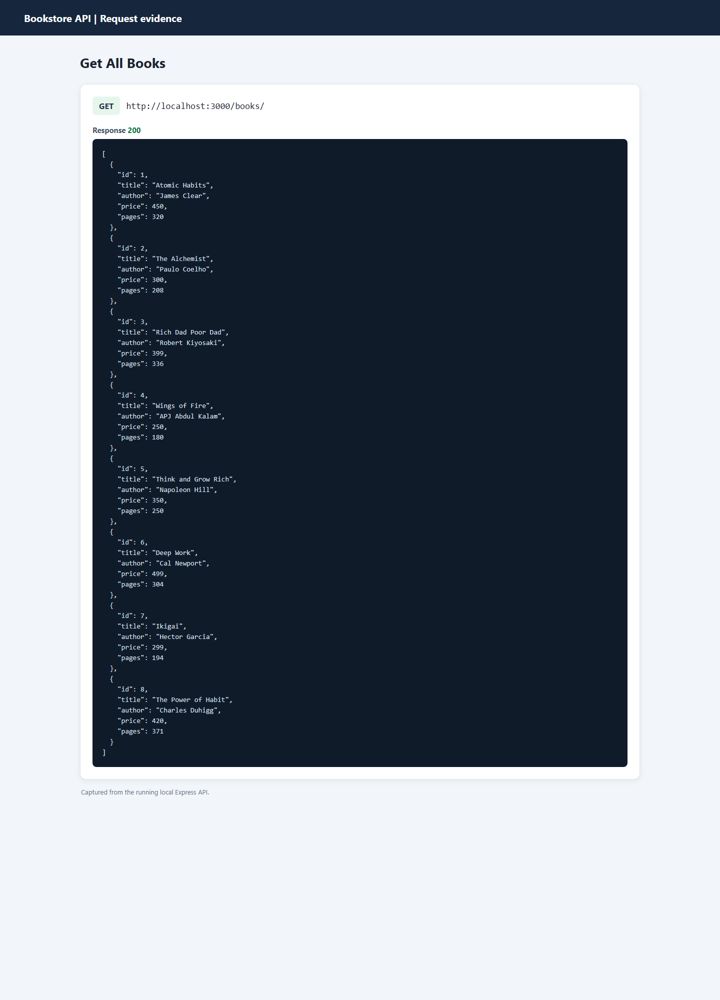
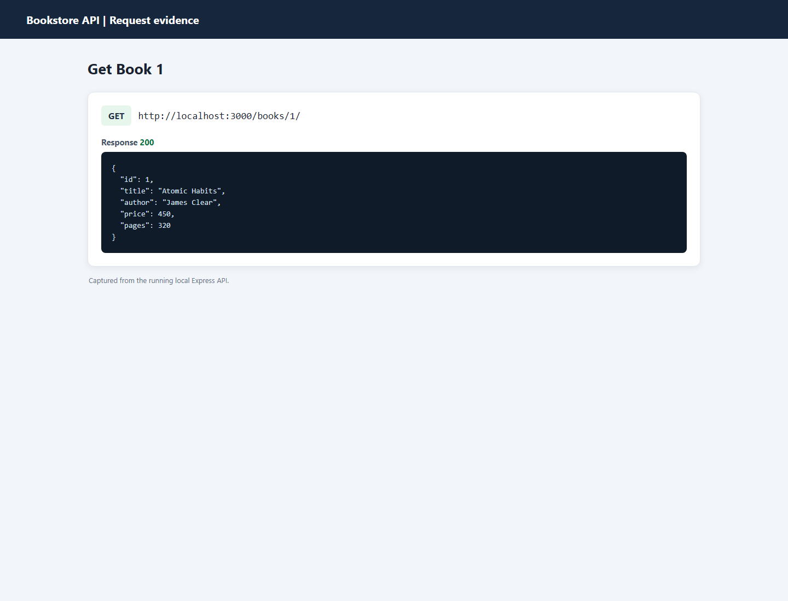
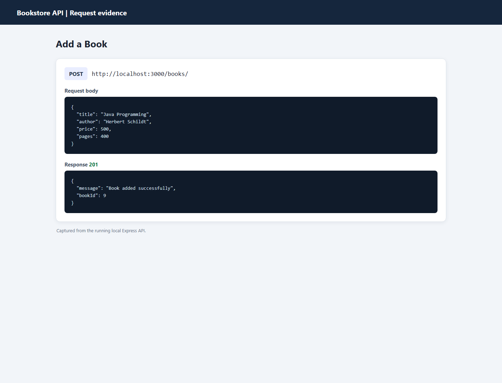
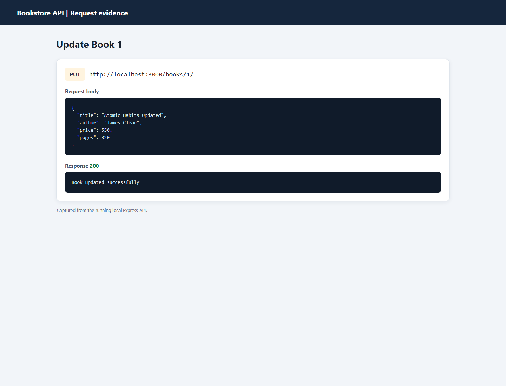
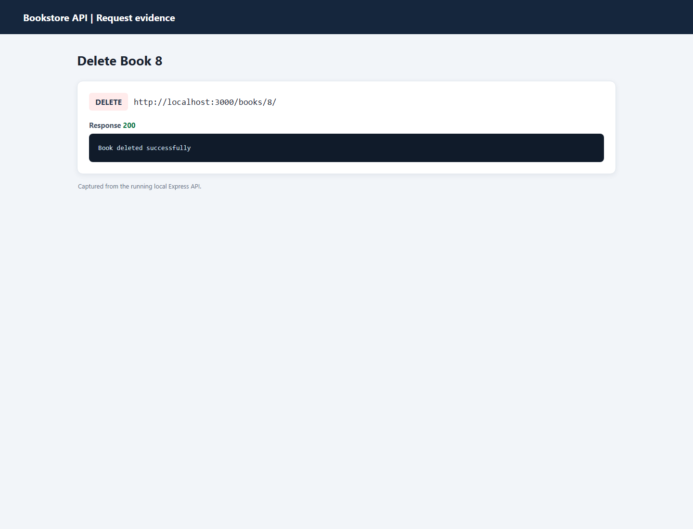
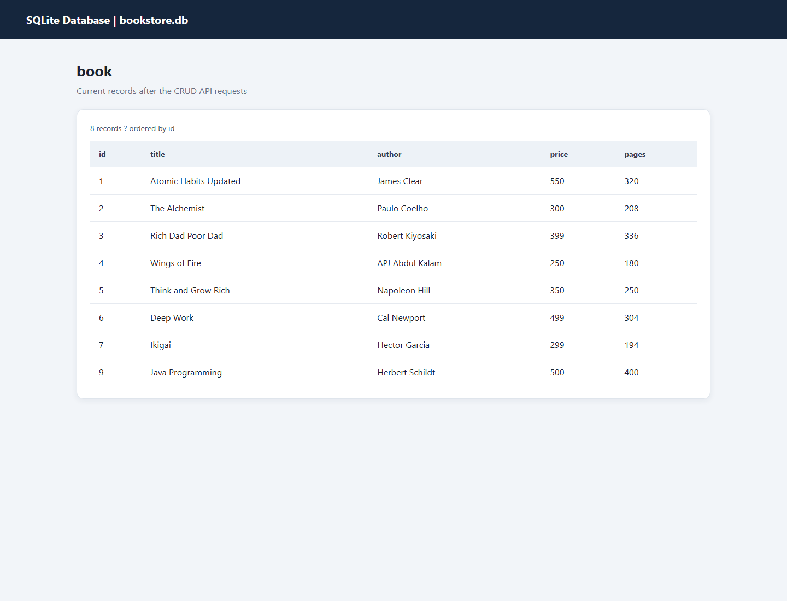

# Lab 2: SQLite Database and CRUD Routes

## Student Details
- **Name:** KOTHAKUNTA PRANAV
- **Registration Number:** 252U1R9074
- **Section:** CSE GAI

## Project Description
A backend application using Node.js, Express.js, and SQLite to perform CRUD operations on books.

## Technologies Used
- Node.js
- Express.js
- SQLite
- SQLite3
- Postman

## Installation
```bash
npm install
```

## Run Project
```bash
npm run dev
```

## API Endpoints

| Method | Endpoint | Description |
|--------|----------|-------------|
| GET | `/books/` | Get all books |
| GET | `/books/:bookId/` | Get one book |
| POST | `/books/` | Add a book |
| PUT | `/books/:bookId/` | Update a book |
| DELETE | `/books/:bookId/` | Delete a book |

## Screenshots

### Get All Books


### Get One Book


### Add Book


### Update Book


### Delete Book


### Database


## Problems Faced
- Handled SQLite async/await promise resolving by utilizing the `sqlite` wrapper around `sqlite3`.
- Ensured proper parameter binding in SQL queries to prevent SQL injection and properly handle missing records (404 status).
